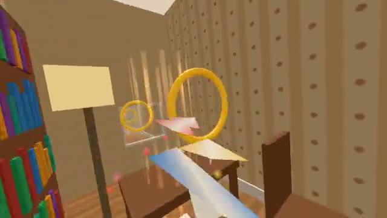

# Glide Race

Paper planes race down a giant house. A multiplayer starter game from [Multiplayer Agent](https://multiplayeragent.com): 3D, versus, 2–8 players, with bots that fill empty seats.

## How it plays

Launch off a bookshelf and glide room to room through the doorways. You sink all the time: dive for speed, ride the warm air up from the floor vents, and fly through the gold rings for a boost. Crash into the furniture and you start again from the last doorway; first out of the window wins.

**Controls:** Left/Right to turn, Up to climb, Down to dive (or WASD), or on-screen buttons.

## Make it yours in the Game Builder

Open the [Game Builder](https://multiplayeragent.com), choose **Start from a starter game** and pick Glide Race. It opens as version 1 in your studio, ready to play and publish. Then ask for changes, for example:

- Add a ceiling fan that blows planes sideways
- Make it a canyon with rock arches instead of a house
- Add a paper airplane skin picker

## Run it yourself

1. Get a free publishable key (`pk_…`) at [multiplayeragent.com](https://multiplayeragent.com).
2. In `index.html`, put it in place of `pk_REPLACE_ME` in the `MP_CONNECT` block.
3. Serve the folder (for example `npx serve`) and open it. The 3D engine loads as a module, which browsers block from a file on disk.

Without a key it still runs, offline against bots.

## How it is built

- One `index.html`, plus three.js in `libs/`. The comment at the top of the script maps the code and explains the multiplayer.
- **Leaderboard:** The fastest flights through the house.
- **Host-run rounds:** The host's browser starts each race and posts the results; if it leaves, the next player takes over.
- **Bots:** Bots fly the rings, and now and then clip a doorway, until enough people join.
- **Live sync:** Every paper plane glides through the same house for everyone at once.
- `?attract` runs it offline with bots only. The preview video is recorded from it.

## License

MIT.
